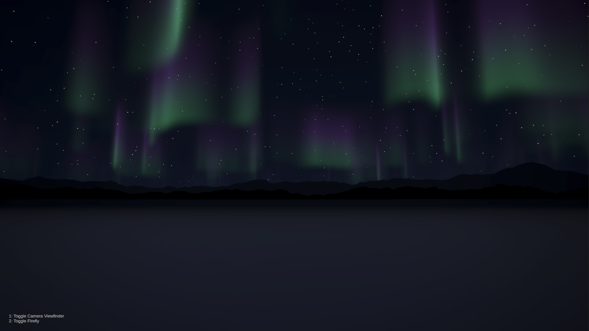
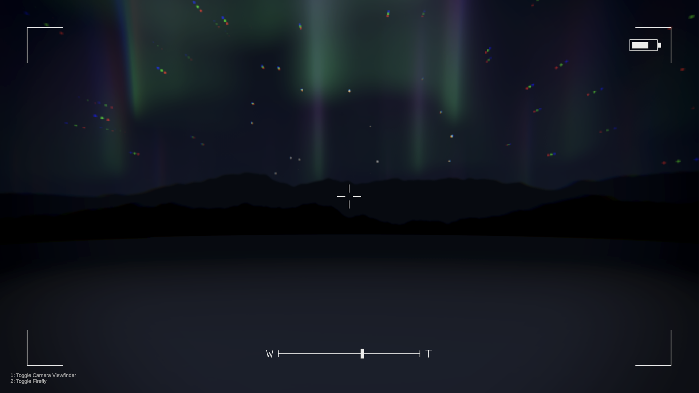
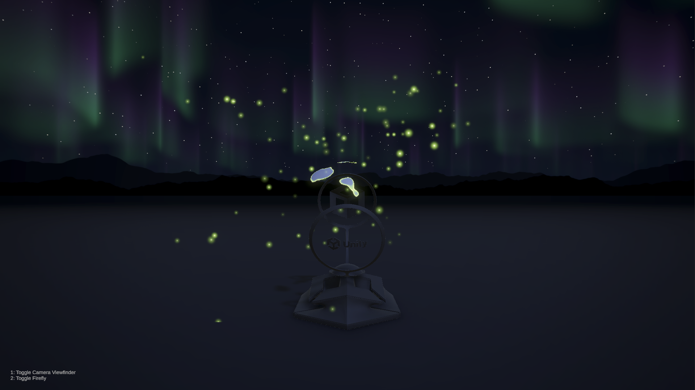

# SUBMISSION.md — 나만의 셰이더 제작

> 오로라가 뜬 밤하늘 아래, 캠코더로 반딧불이 되어 사라지는 물체를 찍는 장면

| # | 셰이더 | 분야 | 방식 | 핵심 기법 |
| --- | --- | --- | --- | --- |
| 1 | [AuroraSky](Assets/02.%20MyShaders/01_AuroraSky/AuroraSky.shader) | 스카이박스 | HLSL | 레이마칭, 도메인 워핑, 사전 적분, 디더링 |
| 2 | [CameraViewfinder](Assets/02.%20MyShaders/02_CameraViewfinder/CameraViewfinder.shader) | 전체 화면 후처리 | HLSL (Full Screen Pass) | 화면 UV 왜곡, 색수차, SDF 도형 |
| 3 | [FireflyDissolve](Assets/02.%20MyShaders/03_FireflyDissolve/FireflyDissolve.shader) + [FireflyParticle](Assets/02.%20MyShaders/03_FireflyDissolve/FireflyParticle.shader) | 3D 메시 + 파티클 | HLSL | 노이즈 임계값 자르기, 가장자리 발광, 파티클별 깜빡임 |

세 셰이더는 모두 `Shader "MyShaders/<이름>"` 경로의 HLSL 코드로 작성했습니다.

---

## 데모 씬

- 씬: `Assets/00. Scenes/MyShader_주현진.unity`
- 구성: AuroraSky 스카이박스, Fog, 어두운 바닥, FireflyDissolve 를 입힌 셰이더볼, 전체 화면 CameraViewfinder

### 조작

| 입력 | 동작 | 스크립트 |
| --- | --- | --- |
| `1` | 캠코더 뷰파인더 켜기 / 끄기 | `ViewfinderToggle` (Main Camera) |
| `마우스 휠 스크롤` | 뷰파인더 줌 인 / 아웃 (뷰파인더가 켜져 있을 때) | `ViewfinderToggle` |
| `2` | 셰이더볼이 반딧불이 되어 사라짐 / 다시 생김 | `FireflyDissolveController` (셰이더볼 루트) |
| `마우스 우클릭 + 드래그` | 제자리에서 시점 회전 | `RightClickLook` (Main Camera) |

### 필요한 설정

- `PC_Renderer` 에 **Full Screen Pass Renderer Feature** 추가 (Pass Material: `CameraViewfinder.mat`, Injection Point: After Rendering Post Processing)
- Main Camera 의 **Post Processing** 켜기 + Global Volume 의 **Bloom** (HDR 발광이 번지게)

---

## 1. AuroraSky — 오로라 밤하늘 스카이박스



### 동작 원리

스카이박스 메시는 카메라를 감싸고 있어서, **정점 위치를 정규화하면 그 픽셀이 바라보는 하늘 방향(`dir`)** 이 됩니다. 모든 요소를 이 방향 벡터 하나로 계산합니다.

1. **하늘 그라데이션**
   `dir.y`(시선 높이)로 지평선 색에서 천정 색까지 보간합니다. `pow(dir.y, 1 / 폭)` 로 지평선 근처 그라데이션 폭을 조절하고, 지평선 아래는 땅 색으로 덮습니다.

2. **별**
   `dir * 밀도` 를 3D 격자로 나누고, 칸마다 해시로 "별이 있는지 / 칸 안 어디에 있는지 / 색" 을 정합니다. 구면 UV 를 쓰지 않아 극점과 이음매가 생기지 않습니다. 별마다 다른 위상의 `sin(time)` 으로 반짝입니다.

3. **오로라 (레이마칭)**
   하늘 위 높이 `1 ~ 1 + 높이` 사이에 수평 평면을 여러 장(기본 48장) 두고, 시선이 각 평면과 만나는 점 `p = dir.xz * (평면 높이 / dir.y)` 에서 노이즈를 읽어 빛을 누적합니다. 평면마다 같은 무늬가 원근에 따라 조금씩 다른 위치로 찍히므로, 누적하면 **세로로 길게 늘어진 커튼** 이 됩니다.
   - **띠 모양:** 노이즈 값이 0.5 인 등고선 근처만 밝히는 리지(ridge) 함수 `(1 - |n - 0.5| / 두께)^선명도`
   - **도메인 워핑:** 큰 노이즈로 좌표 자체를 휘게 해서 커튼이 구불구불 접힘
   - **두 층 노이즈:** 1층은 띠 모양을 정하고, 2층은 띠의 일부만 남기는 마스크로 씁니다. 두 층을 **서로 다른 화면 속도**(1층 0.4, 2층 0.8)로 흘려 무늬가 통째로 미끄러지지 않고 계속 바뀝니다.
   - **색:** 커튼 아래(초록) → 위(보라)로 높이에 따라 보간, 위로 갈수록 옅어짐

4. **언덕 실루엣**
   방위각마다 노이즈로 능선 높이를 정하고, `dir.y` 가 그보다 낮으면 실루엣으로 칠합니다. 방위각을 각도가 아닌 **원 위의 점 `normalize(dir.xz)`** 으로 노이즈에 넣어 360도 한 바퀴의 이음매가 없습니다. 먼 능선(옅은 남색) 위에 가까운 능선(검정)을 겹쳐 깊이감을 줍니다. 경계는 `fwidth` 로 픽셀 한 칸만 부드럽게 처리했습니다.

### 직접 바꾸거나 더한 부분 (오로라 계단·물결 무늬 해결 과정)

레이마칭은 평면을 띄엄띄엄 찍기 때문에 **평면 사이 간격이 계단·줄무늬로 보이는 문제** 가 있었고, 이를 해결하는 과정이 이 셰이더에서 가장 많이 고민한 부분입니다. 원인을 확인하려고 셰이더를 Python 으로 옮겨 같은 해상도로 렌더링해 비교했습니다.

| 시도 | 결과 | 배운 점 |
| --- | --- | --- |
| 픽셀마다 시작 높이를 어긋나게 하는 디더 (IGN) | 대각선 무늬 | IGN 은 계산식 자체에 대각선 방향 반복이 있다 |
| 백색 노이즈(해시) 디더 | 모래 같은 입자 | 이웃 픽셀끼리 값이 뭉친다 |
| 디더 세기 0.6 | 가로 물결 줄무늬 | 디더가 한 단계 간격을 다 메우지 못하면 남은 틈이 평면마다 한 줄씩 남는다 |
| **2옥타브 노이즈 + 사전 적분 + 4x4 Bayer 디더** | 512단계 기준 이미지와 거의 같음 | 셋 중 하나만 빠져도 줄무늬가 다시 생긴다 |

- **2옥타브 노이즈:** 4옥타브의 잔 디테일은 평면 간격보다 촘촘해서 평면마다 다른 무늬가 찍혔습니다. 오로라 전용으로 큰 무늬 2옥타브만 남겼습니다.
- **사전 적분 (pre-integration):** 평면 위 점 하나만 찍으면 가는 띠를 "맞히거나 놓치거나" 둘 중 하나입니다. 두 평면 사이에서 노이즈가 직선으로 변한다고 보고, 띠 함수 `(1 - |u|)^k` 의 적분 `C(u)` 를 미리 구해 **구간 평균을 정확히 계산** 합니다 (`RidgeCdf`, `RidgeAverage`). 구간 양 끝 값은 다음 단계에서 재사용해 계산량은 거의 늘지 않습니다.
- **4x4 Bayer 디더:** 4x4 픽셀 안에 0/16 ~ 15/16 오프셋을 고르게 한 번씩 배치해, 남은 오차를 눈에 띄지 않게 섞습니다.

### 프로퍼티

| 그룹 | 프로퍼티 |
| --- | --- |
| Sky | 천정 색, 지평선 색, 땅 색, 지평선 그라데이션 폭 |
| Stars | 밀도, 크기, 밝기(HDR), 있을 확률, 반짝임 속도 |
| Hills | 먼/가까운 언덕 색, 높이, 굴곡 수, 거칠기 |
| Aurora | 아래/위 색(HDR), 세기, 흐름 속도, 무늬 크기, 커튼 높이, 띠 두께, 띠 선명도, 덮는 정도, 휘어짐, 레이마칭 단계 수, 디더 세기 |

---

## 2. CameraViewfinder — 캠코더 뷰파인더 전체 화면 효과



### 동작 원리

Full Screen Pass Renderer Feature 가 카메라가 그린 화면을 `_BlitTexture` 로 넘겨 주면, 이 셰이더가 화면 전체를 다시 그립니다. 화면 좌표를 화면 비율로 보정한 `p = (uv - 0.5) * (aspect, 1)` 과, 중심에서의 거리 `r` 을 모든 효과의 기준으로 씁니다.

1. **줌 + 배럴 왜곡:** `uv' = 0.5 + (uv - 0.5) / 배율` 로 화면 중심 쪽을 읽어 확대하고, 배율에 `(1 + 왜곡 × r²)` 를 곱해 가장자리일수록 더 휘게 합니다 (볼록렌즈).
2. **색수차:** R, G, B 를 서로 조금 다른 배율로 읽어 가장자리에 색 번짐을 만듭니다. `r²` 에 비례해 중심은 깨끗합니다.
3. **비네트:** `smoothstep` 으로 중심에서 멀수록 어둡게 합니다.
4. **오버레이 (SDF):** 폰트나 텍스처 없이, 선분·사각형·원까지의 거리 함수로 UI 를 그립니다.
   - 모서리 브래킷: `abs(p)` 로 좌우·상하 대칭을 이용해 네 모서리를 한 번에 그림
   - 십자선, 깜빡이는 REC 점, 배터리(테두리 + 잔량 채움)
   - 줌 표시 바: `W ├──■──┤ T`. W, T 글자도 선분 SDF 로 그림
   - 선 두께는 **픽셀 단위** 로 정해 해상도가 바뀌어도 같은 굵기
5. **켜기·끄기 전환:** 전역 변수 `_ViewfinderAmount`(0~1) 하나로 줌·왜곡·비네트·오버레이를 함께 보간합니다. 켜질 때 브래킷이 바깥에서 안으로 모여듭니다.
6. **평소 비네트:** 뷰파인더가 꺼져 있을 때만 가장자리를 살짝 어둡게 하고, 켜지면 뷰파인더 비네트로 자연스럽게 넘어갑니다.

### 직접 바꾸거나 더한 부분

- **스크립트 연동 구조:** `ViewfinderToggle` 이 Renderer Feature 를 껐다 켜지 않고 **전역 셰이더 변수만 보간** 합니다 (`_ViewfinderAmount`, `_ViewfinderZoom`, `_ViewfinderZoom01`, `_ViewfinderZoomUI`, `_ViewfinderIdle`). 머티리얼 값을 Play 중에 바꾸면 에디터에서 `.mat` 파일에 그대로 저장되기 때문입니다.
- **휠 줌:** 배율을 덧셈이 아닌 **곱셈**(한 칸에 12%)으로 바꿔 어느 배율에서든 체감 속도가 같고, 줌 바도 로그 비율로 움직입니다. 목표 배율은 지수 감쇠로 부드럽게 따라갑니다.
- **처음에 넣었던 필름 노이즈·스캔라인·채도 낮추기는 뺐습니다.** "옛 영상의 질감" 이라는 다른 주제가 섞여 셰이더가 보여 주려는 것(렌즈로 들여다보는 화면)이 흐려졌고, 어두운 밤 장면을 뿌옇게 만들었기 때문입니다.
- 셰이더볼 테스트 씬처럼 `ViewfinderToggle` 이 없는 씬에서는 `_ViewfinderIdle` 이 0 이라 평소 비네트도 적용되지 않습니다.

### 프로퍼티

| 그룹 | 프로퍼티 |
| --- | --- |
| Lens | 기본 줌 배율, 배럴 왜곡, 색수차 |
| Vignette | 세기, 시작 반지름, 부드러움 |
| Idle Vignette | 평소 비네트 세기, 시작 반지름, 부드러움 |
| Overlay | 오버레이 색, 선 두께(픽셀), 브래킷 여백·길이, 십자선 크기, REC 색, 깜빡임 속도, 배터리 잔량, 줌 표시 바 길이 |

---

## 3. FireflyDissolve + FireflyParticle — 반딧불 디졸브



물체가 연두빛 가장자리를 따라 사라지고, 사라지는 동안 반딧불이 떠올라 깜빡이며 흩어집니다. **메시 셰이더(디졸브)와 파티클 셰이더(반딧불)** 두 개가 짝을 이룹니다.

### 동작 원리 — FireflyDissolve (메시)

1. **디졸브 값:** 월드 공간 3D 값 노이즈(3옥타브)를 `saturate((n - 0.2) / 0.6)` 으로 0~1 에 고르게 넓히고, "방향 쓸기"(기본: 위에서 아래로) 높이 값과 섞은 뒤 진행 임계값을 뺍니다.
   `d = 노이즈 - 임계값` → `d < 0` 이면 `clip` 으로 잘라 냅니다.
2. **진행값 범위:** 임계값을 `lerp(-가장자리 폭, 1, 진행값)` 으로 잡아, 진행값 0 이면 빛나는 띠까지 하나도 안 보이고 1 이면 완전히 사라집니다.
3. **가장자리 발광:** `0 < d < 가장자리 폭` 인 띠에서, 바깥 색(연두빛)은 띠 전체에 서서히 스며들고 안쪽 색(따뜻한 흰빛)은 잘리기 직전의 얇은 선으로만 더합니다. HDR 값이라 Bloom 으로 번집니다.
4. **조명:** 메인 라이트 램버트 + 그림자 + 환경광(SH) + 블린-퐁 하이라이트. 양면을 그리고, 뒷면(구멍 너머로 보이는 안쪽)은 법선을 뒤집어 어두운 색으로 칠합니다.
5. **보조 패스:** ShadowCaster, DepthOnly, DepthNormals 패스에서도 같은 `d` 로 잘라 **그림자에도 구멍이 뚫립니다.**

### 동작 원리 — FireflyParticle (파티클)

1. **빛 모양:** 작고 밝은 핵 + 넓게 퍼지는 후광, 두 가우시안을 겹칩니다.
2. **깜빡임:** Particle System 의 Custom Vertex Stream 으로 파티클별 난수 `StableRandom.x` 를 `TEXCOORD0.z` 로 받아, 파티클마다 다른 속도·위상의 `sin` 을 만듭니다. 이를 `pow` 로 날카롭게 해서 **대부분 은은하다가 가끔 반짝** 하는 반딧불 리듬을 냅니다.
3. **정점 색:** `Color over Lifetime` 의 알파로 생겨날 때 서서히 켜지고 사라질 때 꺼집니다.
4. **더하기 혼합:** 겹친 빛끼리 밝아지고, 그리는 순서와 상관없이 결과가 같습니다.

### 직접 바꾸거나 더한 부분

- 셰이더 갤러리 '디졸브' 의 노이즈 임계값 비교, 노이즈 범위 넓히기, 그림자 패스 자르기 구조를 바탕으로 했습니다.
- **여러 메시가 하나의 무늬로 이어지게:** 셰이더볼은 메시 4개로 나뉘어 있어 오브젝트 공간 노이즈를 쓰면 파트마다 무늬가 끊깁니다. **월드 공간 노이즈** 를 쓰고, `FireflyDissolveController` 가 4개 메시 전체 바운드로 쓸기 기준점·범위를 MaterialPropertyBlock 으로 넣어 하나의 무늬로 사라지게 했습니다.
- **가장자리 2단 발광, 뒷면 처리, 반딧불 파티클 셰이더** 를 새로 더했습니다.
- **처음에는 "별가루" 를 디졸브 셰이더 안에서 그리려 했습니다.** 사라진 표면 자리에 3D 격자 해시로 반짝이 별을 남기는 방식이었는데, 메시 셰이더는 **메시 표면 위의 픽셀만** 칠할 수 있어 별이 공 모양 껍데기에 붙어 있을 뿐 떠다니지 못했습니다. 그래서 공중을 떠다니는 빛은 파티클 셰이더로 분리했습니다.
- 컨트롤러는 Play 시작 시 반딧불 Particle System 을 코드로 만들고(구 표면에서 생성, 천천히 상승, Noise 모듈로 헤맴), **진행값이 커질 때만 진행된 만큼** `Emit` 합니다.

### 프로퍼티

| 셰이더 | 프로퍼티 |
| --- | --- |
| FireflyDissolve | 기본 색·텍스처, 구멍 안쪽 색, 하이라이트 세기·날카로움, 진행값, 노이즈 크기, 방향 쓸기 섞기·방향·기준점·범위, 가장자리 안쪽/바깥 색(HDR), 가장자리 폭 |
| FireflyParticle | 핵 색·후광 색(HDR), 핵 크기, 후광 크기, 깜빡임 속도, 깜빡임 날카로움, 가장 어두울 때 밝기 |
| FireflyDissolveController | 키, 지속 시간, 자동 반복, 반딧불 수·수명·크기·상승 속도·헤매는 정도 |

---

## 폴더 구조

```
Assets/
├─ 00. Scenes/
│  └─ MyShader_주현진.unity          ← 데모 씬
└─ 02. MyShaders/
   ├─ 01_AuroraSky/
   │  ├─ AuroraSky.shader
   │  └─ AuroraSky.mat
   ├─ 02_CameraViewfinder/
   │  ├─ CameraViewfinder.shader
   │  ├─ CameraViewfinder.mat
   │  └─ ViewfinderToggle.cs
   ├─ 03_FireflyDissolve/
   │  ├─ FireflyDissolve.shader / .mat
   │  ├─ FireflyParticle.shader / .mat
   │  └─ FireflyDissolveController.cs
   └─ RightClickLook.cs               ← 데모용 카메라 회전 스크립트
```

## 참고

- [셰이더 갤러리](https://koohoo-dev.github.io/edu-lecture-shader-gallery/)
  - '노이즈 불꽃': 두 노이즈 층을 다른 화면 속도로 흘리는 원리 → 오로라
  - '디졸브': 노이즈 임계값 자르기, 그림자 패스 자르기 → 반딧불 디졸브
  - '씬 컬러 굴절 유리': 화면 좌표를 밀어 다시 읽는 방식과 색수차 아이디어 → 뷰파인더
